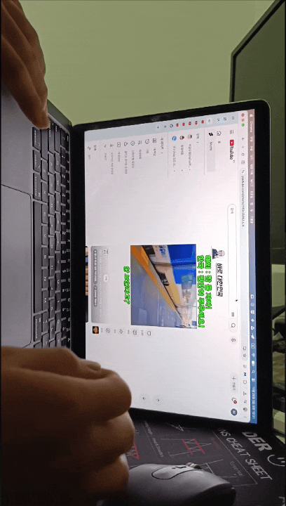

# FlipNinja

A featherweight **macOS menu bar utility** for using your MacBook upright. One keystroke flips the built-in display into portrait for vertical reading and video — and rotates the trackpad's scrolling to match: vertical feed scrolls stay vertical under your fingers. Flip it back just as fast.

[](https://www.swift.org)
[](https://www.apple.com/macos)
[](#)
[](LICENSE)
[](https://buymeacoffee.com/dwyi84d)

---

## Demo

Real footage of FlipNinja in use, filmed on the actual setup — one keystroke (`Control + Fn + O`) turns the MacBook upright for vertical reading:

<p align="center">
  
</p>

<p align="center">
  <b>▶ Watch the full video (MP4, 6.4 MB):</b> <a href="assets/flipninja-demo.mp4">assets/flipninja-demo.mp4</a> — opens in GitHub's file viewer.
</p>

## Features

- **One-Shortcut Flip** — press `Control + Fn + O` anywhere to toggle the main display between `0°` (landscape) and your chosen portrait angle. The keystroke is consumed at the HID event tap, so browsers never see a stray `Control-O`.
- **90° by Default** — the default portrait angle is `90°`, which puts the left-edge USB-C ports at the bottom when the MacBook stands on its left edge. Prefer the other way up? Pick `270°` in the panel or menu; the choice is remembered in `UserDefaults`.
- **Scroll Rotation** — in portrait, two-finger scrolling swaps axes, so swiping "up" relative to the physical laptop still moves through the vertical feed naturally. Landscape passes everything through untouched.
- **Wheel Mice Stay Untouched** — wheel-mouse scrolling is filtered out with the `scrollWheelEventIsContinuous` flag.
- **Menu Bar Panel** — a 320pt NightOwl-style panel with a header, one primary **Portrait Mode** switch, portrait angle, scroll rotation, an inline **Check for Updates** button, and a footer with **Buy me a coffee**, Quit, and Launch at Login. Right-click the icon for a compact version of the same controls.
- **In-App Updates** — the header checks `dwyi84/FlipNinja` on GitHub Releases, downloads a newer `FlipNinja-<version>.zip`, swaps the app in place, and relaunches. The status item menu offers the same check with a result alert.
- **Honest Permission Flow** — at first launch FlipNinja explains why Accessibility access is needed and opens the right System Settings pane. It keeps checking until the grant lands, then starts the event tap without a relaunch.
- **Restores Landscape on Quit** — quitting (or logging out) returns the display to `0°`, so you never leave a sideways desktop behind.
- **Monitor-Panel Icon** — the Finder icon is a silver-bezeled monitor with a glossy screen and a crisp CLI-style `> FlipNinja_` wordmark rotated 90°. The menu bar glyph changes with the active mode: landscape, 90° with the base on the left, or 270° with the base on the right. The **Portrait Angle** menu items carry the same mini icons, and the status menu ends with a `Control + Fn + O` shortcut guide.
- **Vector Icon, No Assets** — all glyphs are pure SwiftUI `Shape`/`Path` art rendered as template images, so they follow the menu bar tint.
- **Tiny & Private** — a single self-contained binary. No third-party dependencies, no analytics, no tracking. The only network request is the optional GitHub Releases update check. Your keystrokes are inspected only for one keycode and never logged.

## Requirements

- macOS 14 (Sonoma) or later
- Apple Silicon (arm64)
- A built-in display that supports rotation (System Settings → Displays → Rotation)
- Xcode Command Line Tools (only if you build from source)

## Installation

### Homebrew (recommended)

```bash
brew install --cask dwyi84/tap/flipninja
```

This installs **FlipNinja.app** to `~/Applications`. Because the app is signed with a local certificate rather than notarized by Apple, Gatekeeper blocks the first launch — right-click the app and choose **Open**, or clear the quarantine flag:

```bash
xattr -dr com.apple.quarantine "$HOME/Applications/FlipNinja.app"
```

### Manual download

1. Open the [latest release](https://github.com/dwyi84/FlipNinja/releases/latest) and download the `FlipNinja-<version>.zip` asset.
2. Unzip it and drag **FlipNinja.app** into your **Applications** folder.
3. On first launch macOS Gatekeeper may warn for the same reason as above. **Right-click the app → Open**, then confirm **Open**.

### Build from source

No Xcode project required — just the Swift toolchain. Clone or download this repository, then:

```bash
cd FlipNinja
make            # compile, assemble dist/FlipNinja.app, sign it
make install    # copy to ~/Applications and launch
```

`make` produces a signed `dist/FlipNinja.app`. `make install` uses `~/Applications` by default; override it with `INSTALL_DIR=/Applications` if you prefer the system folder:

```bash
make install INSTALL_DIR=/Applications
```

Because the app is signed with a local certificate rather than notarized by Apple, Gatekeeper may warn on first launch. Right-click the app and choose **Open**, or clear the quarantine flag:

```bash
xattr -dr com.apple.quarantine "$HOME/Applications/FlipNinja.app"
```

`make run` launches the freshly built bundle from `dist/` without installing it. `make uninstall` removes the installed copy.

## First Launch

1. FlipNinja asks for **Accessibility** access. Click **Open Accessibility Settings**, enable FlipNinja under **Privacy & Security → Accessibility**, and come back — the app notices within a couple of seconds.
2. Check the **Globe (Fn) key** setting. If pressing the Globe key opens Emoji & Symbols, set **Keyboard → Press Globe key to → Do Nothing**. Otherwise that picker can appear alongside the shortcut.
3. Click the laptop icon in the menu bar and press **Rotate to Portrait** (or use `Control + Fn + O`).

## Usage

| Action | Result |
| --- | --- |
| Click the laptop icon | Open the control panel |
| Right-click the icon | Quick menu: open, portrait mode, angle, remap, updates, launch at login, quit |
| `Control + Fn + O` (Globe + Control + O) | Toggle `0°` ↔ portrait |
| **Portrait Angle** | Choose `90°` (USB-C on bottom, default) or `270°` (USB-C on top) |
| **Rotate Scrolling with Display** | Turn scroll rotation on or off |
| **Check for Updates** | Query GitHub Releases and install a newer version |
| **Launch at Login** | Register FlipNinja with `SMAppService` |
| **Quit FlipNinja** | Restore landscape and exit (`⌘Q` in the menu) |

### What gets remapped

With the display at `270°` (device space → screen space):

| Input | Mapping |
| --- | --- |
| Pointer delta `(dx, dy)` | `(-dy, dx)` |
| Scroll vertical / horizontal | `vertical' = -horizontal`, `horizontal' = vertical` |
| Two-finger scroll gate | `scrollWheelEventIsContinuous == 1` only (cursor movement is not intercepted) |
| External wheel mice | Pass through untouched |

At `90°` scroll uses `(vertical' = horizontal, horizontal' = -vertical)`; `270°` is the inverse. At `0°` every event is passed through unchanged.

## Permissions

FlipNinja needs **Accessibility** for the shortcut and the scroll tap. It never reads or stores what you type. The only keycode it looks for is `31` with Control and Fn held.

If a permission gets out of sync after moving or rebuilding the app, reset it and grant it again:

```bash
tccutil reset Accessibility com.melissasoft.FlipNinja
```

If the tap is inactive, the popover shows a compact permission row. Grant access, then press **Retry** to rebuild the taps without relaunching.

## How It Works

- **Display rotation** — the private SkyLight API `SLSSetDisplayRotation` is resolved at runtime with `dlsym`. On recent macOS it takes degrees (`0`, `90`, `180`, `270`); the legacy `CGSSetDisplayRotation` fallback takes quarter-turn indices. `CGDisplayRotation` is the public read-back. Rotation is asynchronous, so FlipNinja updates its state optimistically and polls the real angle (up to 3 seconds) before declaring success.
- **Global shortcut** — a session-level `CGEventTap` with `.defaultTap` consumes the `keyDown` and `keyUp` for keycode `31` when Control + Fn are held; auto-repeat is ignored. A second tap handles scrolling. Both share one dedicated thread and run loop; `tapDisabledByTimeout` is re-enabled automatically.
- **Scroll rotation** — continuous scroll events (trackpads and Magic devices) are remapped; line, point, and fixed-point delta fields are read before any is written, because CoreGraphics keeps the three representations synchronised. Physical wheel mice report zero deltas and pass through untouched. macOS applies built-in-trackpad cursor movement before event taps run, so one-finger pointer rotation is intentionally out of scope.
- **Device detection** — `IOHIDManager` enumerates Generic Desktop / Mouse interfaces and matches `BuiltIn` plus the product name to separate the built-in trackpad and Magic Trackpad from real mice. Pointer remapping pauses while an external mouse is present.
- **No background daemons** — everything runs inside one LSUIElement process. Preferences live in `UserDefaults`; Launch at Login uses `SMAppService.mainApp`; updates use a short-lived detached shell script.

## Limitations

- **Private API** — display rotation is not a public macOS API. Apple has changed the symbol once already; FlipNinja handles both names and fails with a clear alert if neither is available. A future release could remove the capability entirely.
- **Magic Mouse** — it reports continuous scrolling, so its scroll axes are remapped in portrait just like the trackpad. Wheel mice and the cursor itself are not.
- **180°** — the UI exposes only the two portrait angles (`90°` / `270°`). A display left at `180°` is treated as landscape and is not remapped.
- **Globe key action** — macOS may also perform the configured Globe-key action (Emoji & Symbols by default) when the shortcut is used. Set it to **Do Nothing** for a clean experience.
- **External displays** — scroll rotation is global while portrait. If an external display is alongside the rotated MacBook, turn **Rotate Scrolling with Display** off while docked.
- **Quit restores landscape** — if the app is force-killed or crashes while portrait, the display stays rotated; rotate it back from System Settings or launch FlipNinja again.

## Troubleshooting

| Symptom | Fix |
| --- | --- |
| “Couldn't rotate the display” | The display or macOS build does not support rotation. Verify the Rotation menu exists in System Settings → Displays. |
| Shortcut does nothing | Grant Accessibility, then press **Retry** in the popover. Try `tccutil reset Accessibility com.melissasoft.FlipNinja`. |
| Emoji picker opens with the shortcut | Set **Press Globe key to → Do Nothing** in Keyboard settings. |
| Pointer moves in the wrong direction | Pick the other portrait angle. `270°` and `90°` use opposite matrices. |
| Screen stuck in portrait | Quit FlipNinja normally (`Quit` restores `0°`), or set Rotation → Standard in System Settings. |
| Permission resets after every build | FlipNinja uses a stable local signing identity in `~/.flipninja`. If signing fell back to ad-hoc, re-grant Accessibility. |

## Development

Pure Swift Package Manager — no Xcode project:

```bash
swift build -c release   # compile only
make                     # build, bundle, sign
make verify              # codesign --verify --strict
make zip                 # dist/FlipNinja-<version>.zip for releases
make run                 # launch dist/FlipNinja.app
make icon                # regenerate Resources/AppIcon.icns
make clean               # remove .build, build, dist
```

```
Sources/FlipNinja/
├── FlipNinjaApp.swift          # @main, status item, popover, right-click menu
├── DisplayManager.swift        # SkyLight bridge, angle persistence, verification
├── EventTapManager.swift       # HID + session taps, shortcut, input remapping
├── UpdaterViewModel.swift      # GitHub Releases check, download, in-place update
├── InputTransform.swift        # pure scroll rotation math
├── AppSettings.swift           # preferences and transient status flags
├── AccessibilityPermission.swift
├── LaunchAtLogin.swift         # SMAppService login-item toggle
├── FlipNinjaIconView.swift     # vector menu bar + app icon art
└── Views/MainPopoverView.swift # 320pt control panel
```

Version `0.0.1` is the first release. To cut a new version:

1. Bump `CFBundleShortVersionString` and `CFBundleVersion` in `Resources/Info.plist`.
2. Run `make zip` to produce `dist/FlipNinja-<version>.zip`.
3. Publish the zip as a GitHub release asset.
4. Point the Homebrew tap at the new build with `Scripts/update_cask.sh <version>` (the default path is a sibling `../homebrew-tap/Casks/flipninja.rb`), then commit and push the tap.

The in-app updater reads the same release tag (`v<version>`) and expects a `FlipNinja-<version>.zip` asset.

The build signs with a self-signed development certificate stored in `~/.flipninja/flipninja.keychain-db`. That keeps the Accessibility grant stable across rebuilds. If certificate creation is unavailable, the Makefile falls back to an ad-hoc signature.

## Privacy

FlipNinja collects no telemetry and writes nothing about your input. Its only network request is the update check against GitHub Releases (skipped if the network is unavailable). It reads only the display rotation and the single keycode needed for its shortcut; preferences stay in `UserDefaults` on your Mac.

## License

Released under the [MIT License](LICENSE).

## Support

If FlipNinja makes your vertical MacBook setup feel natural, consider buying me a coffee — it keeps the ninja flipping. ☕

[](https://buymeacoffee.com/dwyi84d)

<p align="center">Crafted by MelissaSoft · Made with ❤️ on Apple Silicon.</p>
<p align="center">Copyright © 2026 Dawoon Yi / MelissaSoft</p>
